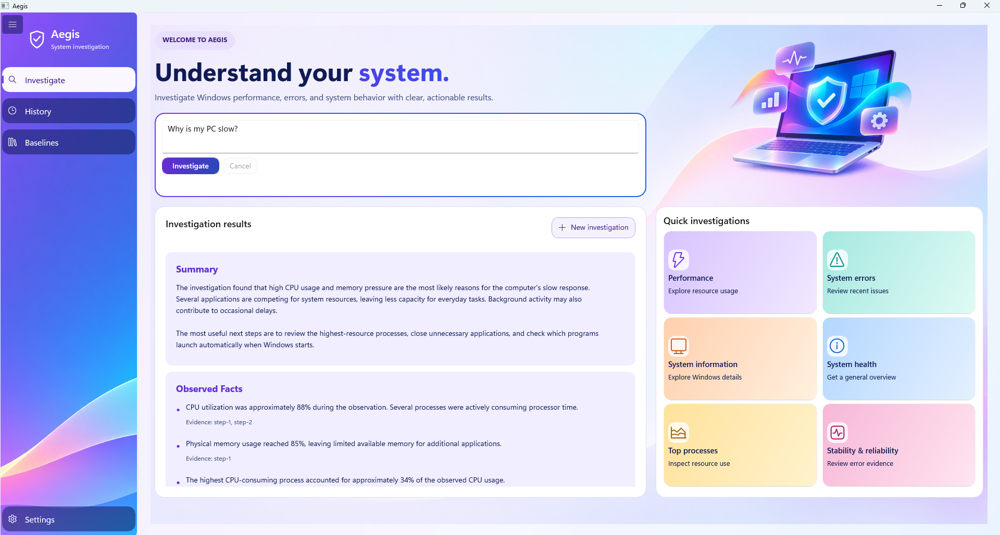
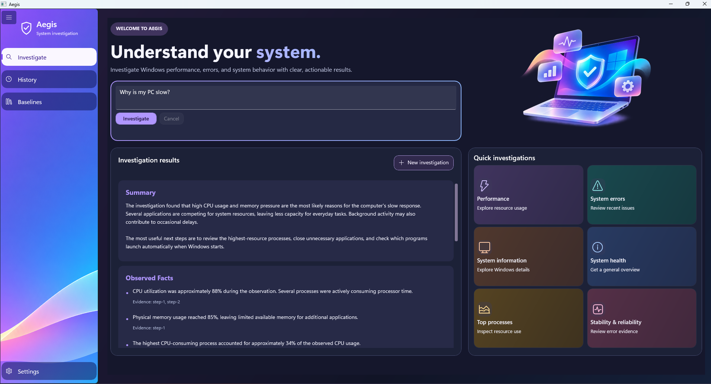

# Aegis

Aegis is a native Windows application for investigating system performance, reliability, and errors through structured observations and evidence-driven reports. It brings findings, supporting evidence, and recommendations together in one desktop workspace.



*Aegis investigation workspace — Spectrum Light.*


## What Aegis does

Aegis combines focused Windows observations with an AI-assisted investigation workflow. Ask a question such as “Why is my PC slow?” and review a structured report alongside its supporting evidence.

- **Investigation reports:** Read summaries, observed facts, conclusions, hypotheses, uncertainty, and recommendations with evidence references.
- **Windows observations:** Inspect Windows version and architecture through explicitly registered, read-only tools.
- **Performance:** Review a bounded CPU and physical-memory snapshot and rankings of accessible processes by CPU usage and working set.
- **Recent errors:** Examine limited Critical and Error event metadata from the local System and Application logs for the previous 48 hours. Event message text is not collected.
- **History and baselines:** Revisit saved investigations and create eligible system-information baselines from validated past observations.

## How investigations work

1. Enter a question or choose a Quick Investigation to populate the composer.
2. A language model proposes a structured investigation plan. Aegis validates the plan and runs approved observations sequentially within a shared budget.
3. The model receives the question and bounded evidence, then produces a structured report. The runtime allows at most one bounded replan.
4. Review the report in the app and return to saved investigations or eligible baselines later.

The runtime validates proposed plans and accepts only registered observation tools. This keeps system access bounded while allowing the report to distinguish observed facts from interpretation.

## Built for Windows

Aegis uses a native WinUI 3 desktop interface with resizable layouts, Spectrum styling, and Light, Dark, and System appearance options. Investigations, history, baselines, and settings are available from the sidebar.



*Aegis investigation workspace — Spectrum Dark.*

## Technology and architecture

- C# and .NET 10
- WinUI 3 and Windows App SDK
- SQLite for local history and baselines
- Provider-neutral AI integration with an OpenAI adapter
- A bounded investigation runtime and xUnit automated tests

## Build and run

### Requirements

- Windows x64
- .NET 10 SDK
- Visual Studio with MSBuild, the Windows SDK, and the components needed to build an unpackaged WinUI 3 application
- NuGet access to restore dependencies

From the repository root, in a Visual Studio Developer PowerShell or a shell with Visual Studio MSBuild on the path:

```powershell
msbuild Aegis.sln /restore /t:Build /p:Configuration=Debug /p:Platform=x64
dotnet test tests\Aegis.Tests\Aegis.Tests.csproj --configuration Debug
.\src\Aegis\bin\x64\Debug\net10.0-windows10.0.26100.0\Aegis.exe
```

## AI configuration

To enable AI-assisted investigations, configure the OpenAI provider using the following environment variables:

```powershell
$env:AEGIS_OPENAI_API_KEY = "<your-api-key>"
$env:AEGIS_OPENAI_MODEL = "gpt-5-mini" # Optional; this is the default.
```

Keep your API key out of source files and version control. The application opens without provider configuration, but live AI-assisted investigations require a configured provider.

## Privacy and project scope

Investigation history, observations, reports, and eligible baselines are stored locally in `%LOCALAPPDATA%\Aegis\aegis.db`. Appearance preferences are stored locally under the same Aegis directory. The API key is read from the process environment and is not persisted by Aegis.

For an AI-assisted investigation, the question and the evidence needed for planning and reporting are sent to the configured provider. Review the provider's policies before including sensitive information.

Aegis is a source-build Windows x64 application. Its investigations are on demand and use a small set of registered read-only observations; it is not a general-purpose computer-control or continuous monitoring tool. AI-generated interpretations can be uncertain and should be read alongside the available evidence.

## Design Philosophy & Future Possibilities

Aegis explores how AI can assist with Windows system diagnostics while keeping observation and control clearly separated.

The current implementation focuses on a deliberately limited set of read-only system observations. This is a design choice: Aegis is intended to help users understand what's happening on their computers, not give an autonomous agent unrestricted access to their systems.

The architecture leaves room for future development, including:

- **Deeper diagnostics:** Broader performance monitoring, resource analysis, and Windows event correlation.
- **Richer investigations:** Multi-step diagnostic workflows, comparisons, and more detailed evidence-based explanations.
- **Visual insights:** Historical trends, performance charts, and clearer relationships between observations.
- **Extensibility:** Additional explicitly approved diagnostic tools with well-defined permissions and execution limits.

Aegis demonstrates a foundation for AI-assisted system investigation, with opportunities to expand its diagnostic capabilities without compromising its read-only, user-controlled approach.

## Copyright and licensing

Copyright © 2026 Ali Akcin.

This project is published for portfolio purposes only.

Unauthorized copying, redistribution, or commercial use of this codebase is prohibited without prior written consent.
